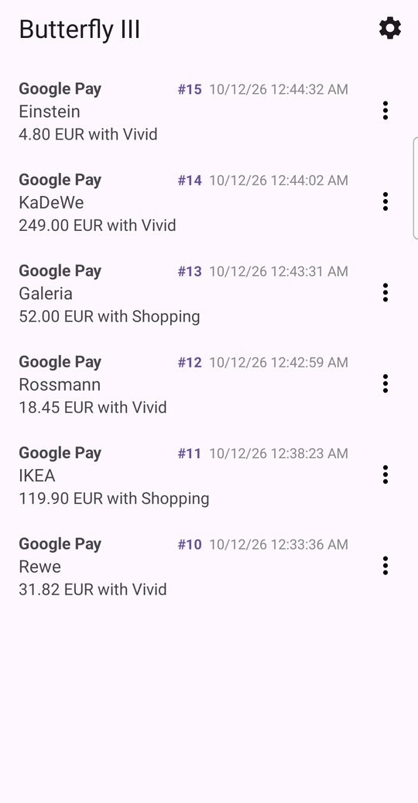
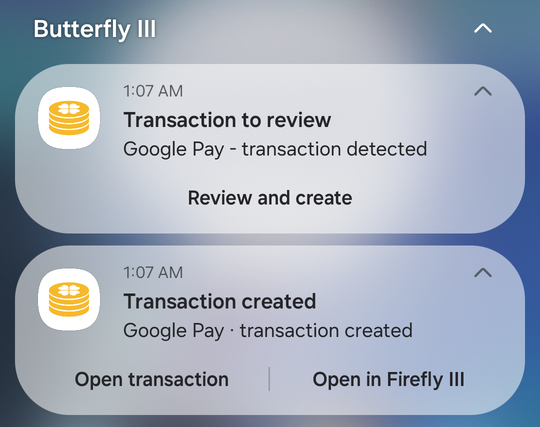
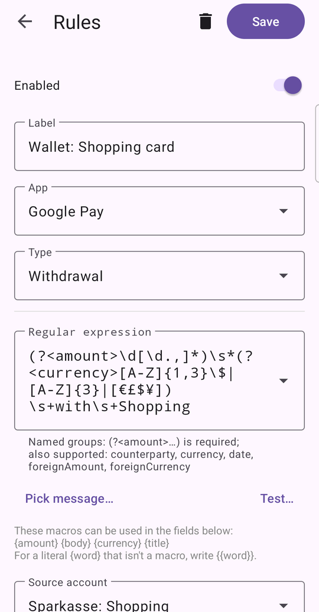

# Butterfly III

*An unofficial Android companion for [Firefly III](https://www.firefly-iii.org/).*

Butterfly III reads the payment notifications on your phone and adds them to
Firefly III for you. It works with Google Wallet and your bank's apps.

<table>
  <tr>
    <td valign="top"></td>
    <td valign="top"></td>
    <td valign="top"></td>
  </tr>
</table>

Your server does not have to be reachable when a payment happens. Butterfly III
saves the notification on your phone, and you can create the transaction later,
for example when you are back in your home network. This is handy on a trip.
See [Using the app without a connection](docs/offline.md).

**Before you start:** you need your own working Firefly III server.
New to Firefly III? Read
[what it is](https://docs.firefly-iii.org/explanation/firefly-iii/about/introduction/).
Want to set one up? Follow
[the Docker installation guide](https://docs.firefly-iii.org/how-to/firefly-iii/installation/docker/).
Other ways to install it are listed on the same documentation site.

Butterfly III is not made by, or affiliated with, the Firefly III project.

Ready? Follow [Getting started](docs/getting-started.md), with screenshots. Every settings screen is described in [Settings](docs/settings.md).

## How it works

1. A payment notification arrives on your phone, for example from your bank's app.
2. Butterfly III finds the amount, the currency and the shop name in the text.
   It uses a *rule* for this. Common notification formats work out of the box.
   You can also write your own rules: see [Rules](docs/rules.md).
3. Butterfly III creates the transaction in Firefly III.
   Or it sends you a notification, so you can check the details first.
   You choose which one.

## What it can do

- Reads notifications only from the apps you pick.
- Comes with rules for common formats. You can add your own.
- Creates transactions on its own, or lets you review each one first.
- Spots duplicates. For example, when your bank app and your wallet app both
  report the same payment, you get one transaction, not two.
- Handles payments in a foreign currency.
- Backs up and restores your settings and rules.

## What you need on your phone

- Android 8.0 or newer.
- Permission to read notifications. Android asks you for this, and the app
  explains why it is needed.
- The address of your Firefly III server and a personal access token.
  You create the token in Firefly III, in your profile.

The app is available in English, Russian and German.

## Privacy

Butterfly III reads and understands your notifications on your phone.
It has no server of its own.

The only thing that leaves your phone is the finished transaction, and it goes
to your own Firefly III server. The address of your server and your access token
stay on your phone.

One more case: for a payment in a foreign currency, the app can ask a public
exchange-rate service for a rate. It sends only the two currency codes and the
date. It never sends your notification text or any amounts.

## License

Butterfly III is free software, released under the
[GNU General Public License, version 3 or later](LICENSE).

Copyright (C) 2026 Maximus5

## Questions and problems

Please open an issue on
[GitHub](https://github.com/Maximus5/butterfly-iii/issues).
Do not post real bank details, card numbers or access tokens there.
