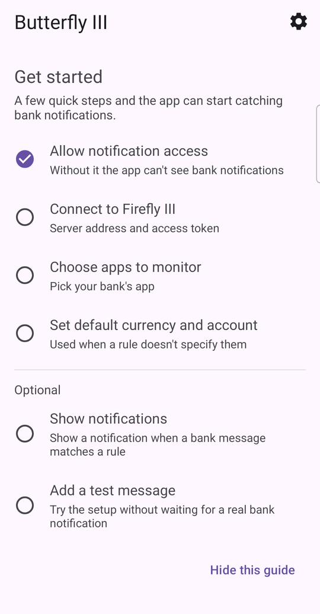
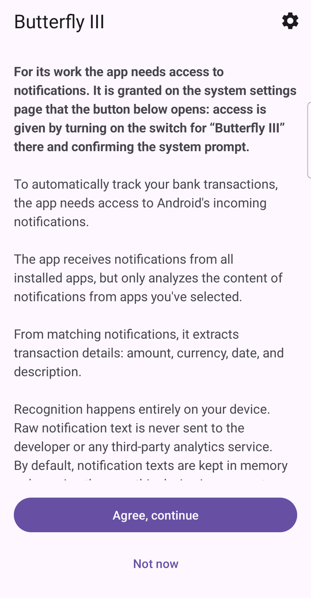
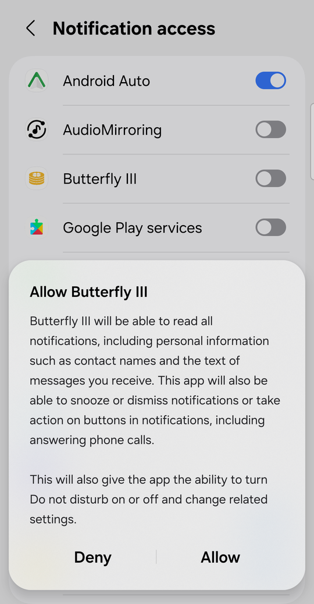
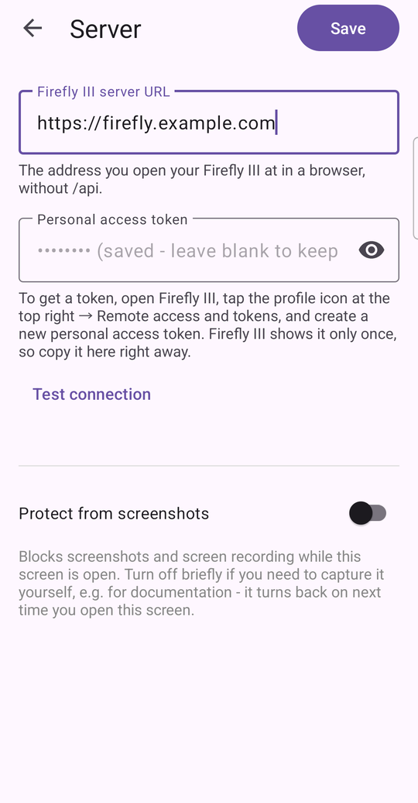
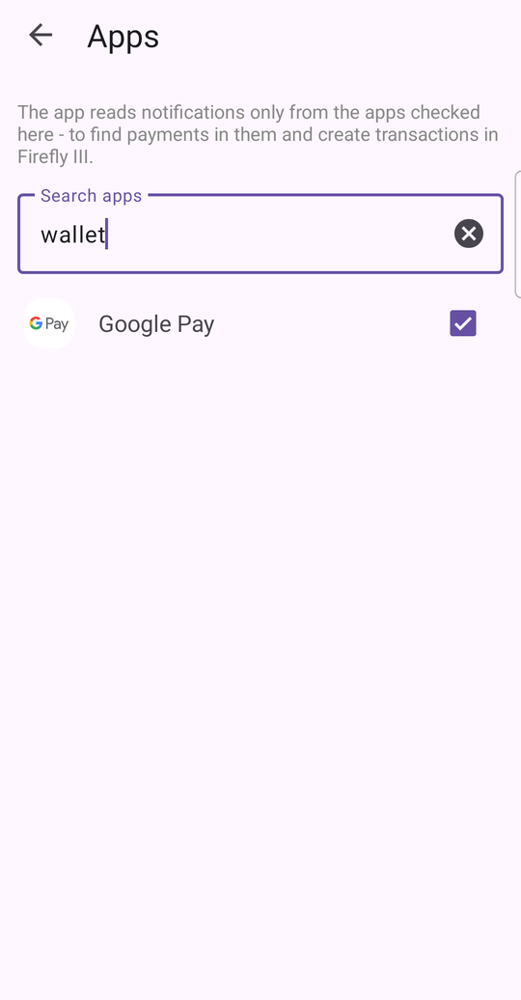
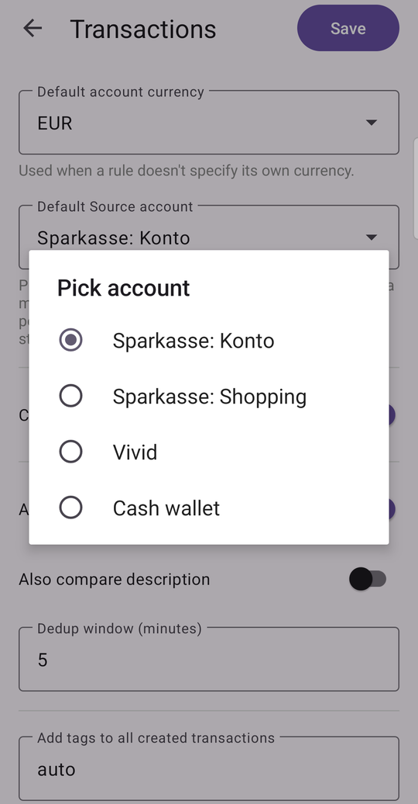
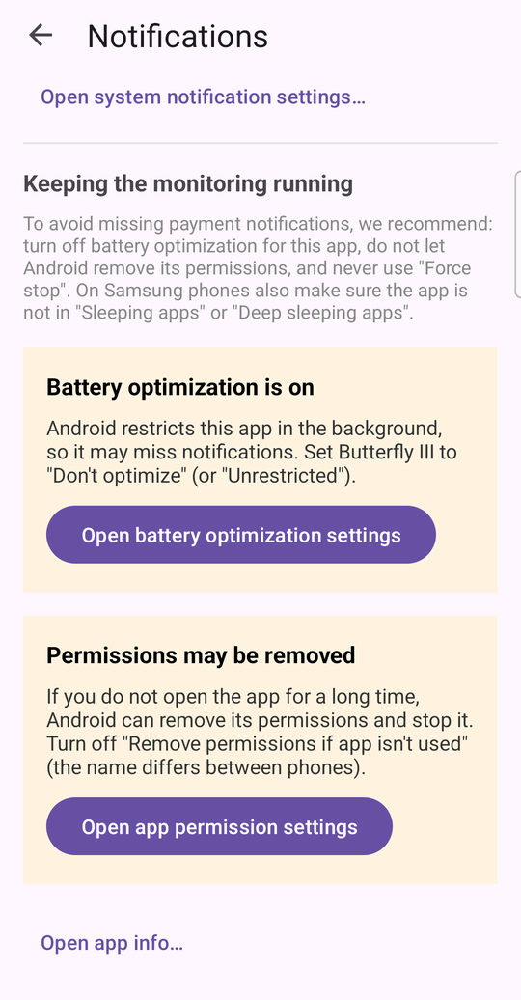
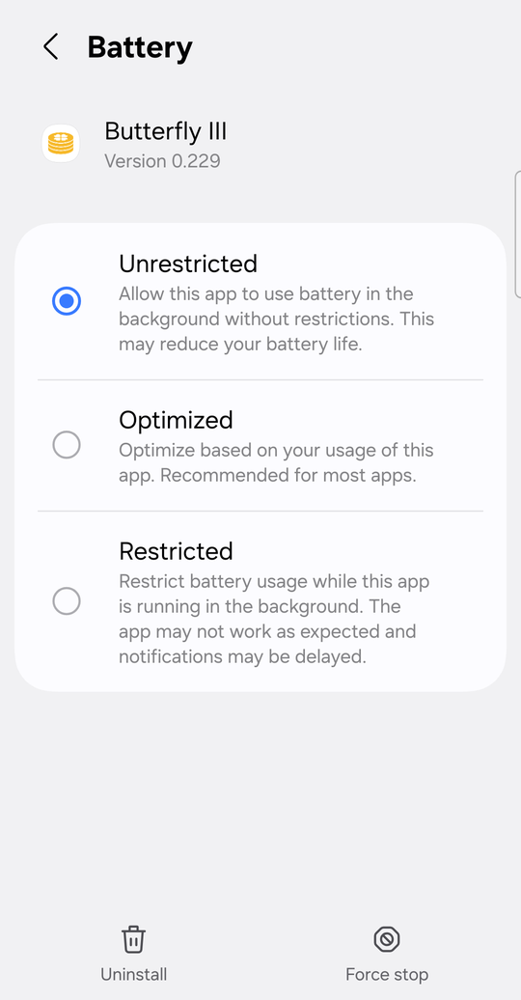
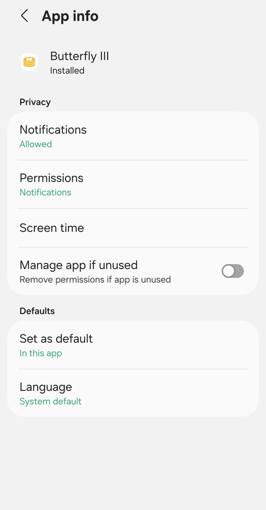
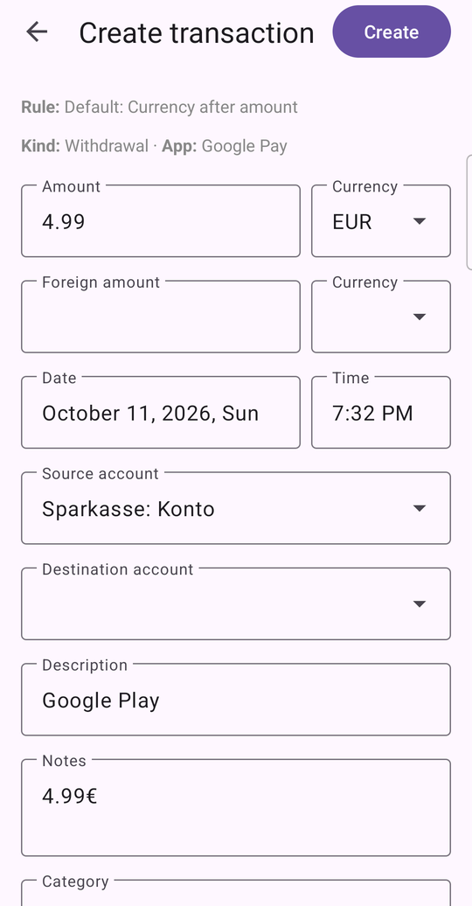

# Getting started

This page takes you from a fresh install to your first transaction in
Firefly III. It takes about five minutes. The screenshots are from the English
version of the app. It is also available in Russian and German.

## Before you start

You need a working Firefly III server and a personal access token for it.
To create the token, open Firefly III in a browser, tap the profile icon at the
top right, go to *Remote access and tokens*, and create a new personal access
token. Firefly III shows the token only once, so copy it right away.

Butterfly III shows a short *Get started* checklist on its first screen. The
steps below follow it.

## 1. Allow notification access

Butterfly III reads the payment notifications that other apps show. Android
only allows this after you grant *notification access*.

1. Read the short explanation and tap **Agree, continue**.
2. Android opens its *Notification access* page. Turn on the switch for
   **Butterfly III** and confirm the question that follows.

 

The app only analyzes the notifications of the apps you choose in step 3.
Nothing leaves your phone except the finished transaction, which goes to your
own server.

## 2. Connect to Firefly III

1. Open **Settings → Server**.
2. Enter the address you use to open Firefly III in a browser, without `/api`.
3. Paste the personal access token.
4. Tap **Test connection**. You should see the version of your Firefly III.
5. Tap **Save**.

Once saved, the token is never shown again. The field says *saved - leave
blank to keep*. This screen blocks screenshots by default. The switch at the
bottom turns that off for the time you have the screen open.

After you save, the app fills in your default currency and account when
there is only one choice.

## 3. Choose the apps to watch

Open **Settings → Monitored apps**, search for your bank or wallet app, and
tick it. Butterfly III reads notifications only from the ticked apps.

## 4. Set a default currency and account

Open **Settings → Transactions**. Pick the currency and the account that are
used when a rule does not say which ones to use. The built-in rules do not know
your accounts, so they need this.

The same screen decides how transactions are created:

- **Create transactions automatically** is off at first. You get a
  notification to review each payment. Turn it on once you trust your rules.
- **Avoid duplicate transactions** keeps two apps that report the same payment
  from creating two transactions.

## 5. Keep the monitoring running

Android can stop apps it thinks you do not use. If it stops Butterfly III, you
miss payments. Open **Settings → Notifications**. In *Keeping the monitoring
running*, the app tells you if something needs your attention and opens the
right system page for you.

- **Battery optimization.** Set Butterfly III to *Unrestricted* (or *Don't
  optimize*, depending on your phone).
- **Permissions may be removed.** In the app's system page, turn off *Manage
  app if unused* (or *Remove permissions if app isn't used*). The name
  differs between phones.

 

More about this, and about Samsung's *Sleeping apps*, is in
[Using the app without a connection](offline.md#keep-the-app-running-in-the-background).

## 6. Try it with a test message

You do not have to wait for a real payment. Tap **Add a test message** in the
checklist (or open **Settings → Message history → Add test message**). Choose
the app, enter a title and a text such as `Google Play` and `4.99€`, and tap
**Add**.

The message appears in the list. A built-in rule recognizes the amount and the
currency in it.

Tap the message. A screen opens with the transaction the rule worked out:
amount, currency, date, accounts, description. Check the details, change what
you need, and tap **Create**. The message in the list now shows the number of
the new transaction, and you can find it in Firefly III.

If you leave this screen after changing something, the app asks whether to
keep editing or discard your changes.

## What next

- Your own payments will show up as notifications, and the app proposes a
  transaction for each. Tap one to review and create it.
- Rules decide how a notification becomes a transaction. The built-in ones
  work for common formats. You can write your own in **Settings → Rules**.
- To use the app while your server is out of reach, see
  [Using the app without a connection](offline.md).
